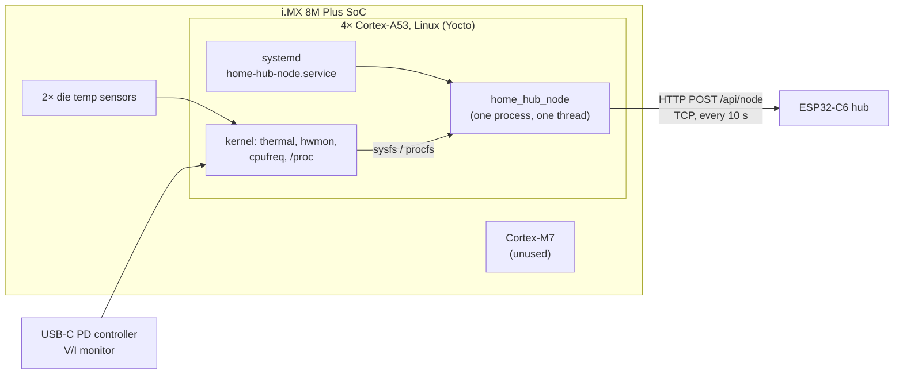
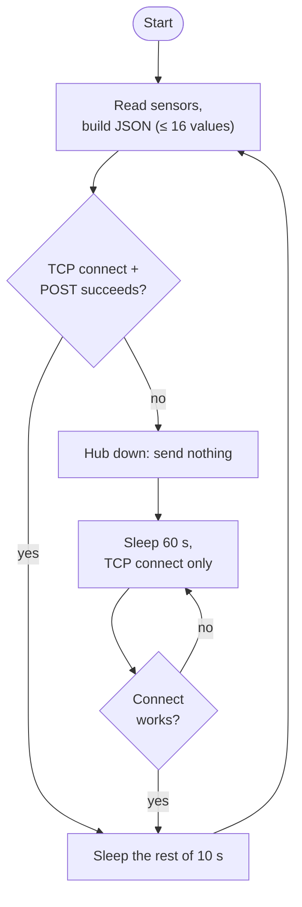

# home_hub_node architecture

How the i.MX 8M Plus reports to the ESP32-C6 Home Hub. Build, deploy and
test: [README.md](README.md). The hub side:
[ESP32C6-Zephyr-IoT-Projects/applications/web_app](https://github.com/bbzorba/ESP32C6-Zephyr-IoT-Projects/tree/main/applications/web_app).

## 1. Where it runs

| Part | Job |
|---|---|
| systemd unit | starts the node at boot (after `network-online.target`), restarts it 10 s after a crash |
| `home_hub_node` | reads sensors through sysfs/procfs, builds the JSON report, POSTs it |
| Linux kernel drivers | thermal zones (CPU, SoC), hwmon (USB-C PD), cpufreq, `/proc/stat`, `/proc/meminfo` |
| Cortex-M7 | not used; would need the `-rpmsg` device tree (see the top-level README) |

No kernel module, no extra library: plain glibc sockets and file reads,
so the binary survives any Yocto rebuild that keeps glibc compatible.

## 2. Main loop

| Timing | Value | Where |
|---|---|---|
| Report period | 10 s, measured on `CLOCK_MONOTONIC` | `PERIOD_S` |
| Retry while the hub is down | 60 s, connect only | `RETRY_S` |
| Connect / send / receive timeout | 5 s (`SO_SNDTIMEO`, `SO_RCVTIMEO`) | `TIMEOUT_S` |
| Hub marks the node offline | 30 s without a report | hub, `nodes.c` |

## 3. Data path

| Value | Source | Notes |
|---|---|---|
| CPU / SoC temperature | `/sys/class/thermal/thermal_zone*/temp` | m°C → °C |
| USB-C V / A | `/sys/class/hwmon/*/in0_input`, `curr1_input` | only when non-zero |
| CPU load | `/proc/stat` | delta since the previous report |
| CPU frequency | `cpufreq/scaling_cur_freq` | average over all cores |
| Load avg, memory, disk, uptime | `/proc/loadavg`, `/proc/meminfo`, `statvfs("/")`, `/proc/uptime` | |

Node id = hostname, model = `/proc/device-tree/model`.

## 4. Crucial points

- **Stateless towards the hub.** One TCP connection per report, nothing
  buffered while the hub is away: after an outage the hub simply gets the
  current values again.
- **Back off when the hub is down.** Only a bare connect every 60 s, so a
  missing hub costs neither CPU nor network.
- **systemd, not `.bashrc`.** `.bashrc` runs only on a login; the unit
  starts at boot and restarts after crashes.
- **Rebuilt images wipe `/opt/home-hub`.** Run `make deploy` after
  flashing a new Yocto image, or add a recipe to the layer.
